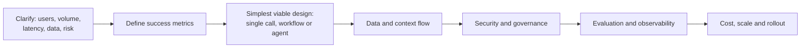

# System Design Interview Questions

Twenty-six whiteboard-style prompts for AI engineer and solution architect interviews, each with a model answer:
clarifying questions, an architecture, the key trade-offs and what interviewers look for. All scenarios and
organisations are fictional and original.

> **How to practise:** set a 35-minute timer. Spend 5 minutes on clarifying questions, 15 on the architecture,
> 10 on trade-offs and risks, 5 on how you would evaluate and operate it. Then compare with the model answer.
> Model names and API features are **as of 2026-10-24**.

## A reusable answer framework

Interviewers consistently reward: asking about **requirements before drawing**, choosing the **simplest pattern**
that works, treating model output as **untrusted**, naming **how you will measure quality**, and giving **numbers**
(volumes, latency budgets, cost per task) even if rough.

---

### 1. Policy assistant for 20,000 employees

**Prompt:** Northwind Lending wants an internal assistant that answers HR, IT and compliance policy questions with
citations. Policies live in a document management system with department-level permissions.

**Clarify:** How many documents and how often do they change? Do permissions vary per user? Which languages? What
happens when the answer is not in policy? Any regulated content?

**Architecture:** Ingestion service listens to document change events → parser (PDF, Word) → structure-aware chunking
with title and section headers → hybrid index (keyword plus embeddings) with metadata: department ACL, version,
effective date. Query path: authenticate the user (SSO) → retrieve with **ACL filters applied before ranking** →
rerank → Claude Sonnet 5.5 with documents as `document` blocks and citations enabled → answer with citations, or
"not covered, contact HR" → feedback buttons. Stable system prompt cached.

**Trade-offs:** RAG vs whole-document context (corpus too large and permissioned for long context); Sonnet for
latency and cost, Opus for complex compliance questions via routing; freshness vs ingestion cost.

**What interviewers look for:** permission filtering at retrieval time, not after generation; citations and a refusal
path; versioning and delete propagation; an eval set of real questions with expected sources; feedback loop.

### 2. Contract clause extraction at scale

**Prompt:** Fabrikam Insurance must extract 40 fields (renewal date, liability cap, governing law and so on) from
300,000 legacy contracts, then keep up with about 500 new contracts a week.

**Clarify:** Accuracy target per field? Is human verification required? Scanned or digital? Deadline for the
back-catalogue?

**Architecture:** Back-catalogue through **Message Batches** (50% cheaper, latency tolerant) with structured outputs
(JSON Schema of the 40 fields, each with value, quote and confidence). New contracts through the same prompt on the
synchronous API. Validation layer: schema, date parsing, cross-field rules (end date after start date). Low-confidence
or rule-failing records go to a human review queue; reviewed corrections feed the eval set.

**Trade-offs:** one call for 40 fields (cheaper, cached prefix) vs field groups (more accurate on long contracts);
model choice by measured accuracy per field; quotes add tokens but make review fast.

**What interviewers look for:** batch for the back-log, structured outputs, evidence quotes, deterministic validation,
human review sized by measured error rates, results keyed by `custom_id`.

### 3. Repository maintenance agent in CI

**Prompt:** Acme Logistics wants an agent that upgrades dependencies, fixes the resulting test failures and opens
pull requests across 200 repositories.

**Clarify:** Which languages and build systems? Can it merge, or only propose? Network access? Secrets in CI?

**Architecture:** Scheduler → per-repo job in an isolated container with no production secrets → Claude Code in
headless mode (or the Agent SDK) with a narrow allowlist (`Bash(npm test *)`, package manager commands, file edits),
`--max-turns`, and a `PreToolUse` hook that blocks network calls outside the package registry → agent runs tests,
iterates → opens a PR with a summary and test evidence → human review and normal CI gates before merge.

**Trade-offs:** autonomy vs blast radius (propose-only); Opus at high effort for hard fixes vs Sonnet for routine
bumps; per-repo `CLAUDE.md` for conventions.

**What interviewers look for:** sandboxing, least privilege, turn and cost caps, humans approving merges, evidence in
PRs, metrics (merge rate, revert rate).

### 4. Security alert triage assistant

**Prompt:** A security operations centre gets 8,000 alerts a day; analysts want an assistant that enriches and
prioritises them.

**Clarify:** Which SIEM and tools? Is the assistant allowed to take containment actions? False-negative tolerance?

**Architecture:** Alert stream → enrichment workflow (code calls threat intel, asset inventory, identity directory) →
Claude Haiku 5.5 classifies and summarises with structured output (severity, rationale, evidence links) → high or
uncertain cases escalate to Claude Opus 5.5 with read-only investigation tools via MCP (log search, host lookup) →
analyst queue sorted by priority. Containment actions are **suggested**, executed only after analyst approval.

**Trade-offs:** tiered models for cost; deterministic enrichment rather than agent exploration for common alerts;
alert text is attacker-controlled, so injection risk is real.

**What interviewers look for:** treating alert payloads as untrusted input, read-only tools by default, approval for
response actions, audit logs, measured precision/recall against analyst labels.

### 5. Meeting summaries with action items

**Prompt:** Tailspin Retail wants transcripts of internal meetings summarised, with action items pushed to their task
tracker.

**Clarify:** Consent and retention for recordings? Who sees summaries? Are action items created automatically?

**Architecture:** Transcript (from the meeting platform) → redaction of sensitive data per policy → Claude with
structured output: summary, decisions, action items (owner, due date, quote) → owner confirms items in a review UI →
task tracker API creates tasks. Long meetings: chunk by agenda item, then synthesise.

**Trade-offs:** automatic creation vs confirmation (confirmation avoids noise and wrong assignments); Haiku vs Sonnet
on quality of owner attribution.

**What interviewers look for:** privacy and consent, evidence quotes to fight hallucinated tasks, human confirmation,
access control on summaries.

### 6. Adding Claude to a multi-tenant SaaS product

**Prompt:** Woodgrove Analytics serves 3,000 business customers and wants an "ask your data" feature in its product.

**Clarify:** Data per tenant? Contractual restrictions on AI processing? Free vs paid tiers? Peak concurrency?

**Architecture:** Gateway service between the product and the Claude API: tenant authentication, per-tenant rate
limits and token budgets, prompt templates versioned centrally, request logging with tenant ID. Retrieval and tools
always scoped by tenant ID enforced in code. Opt-in per tenant with data-processing terms; regional processing options
where required.

**Trade-offs:** shared vs per-tenant workspaces/keys (cost attribution and blast radius vs management overhead);
caching across tenants only for tenant-independent prefixes.

**What interviewers look for:** strict tenant isolation, noisy-neighbour protection, cost attribution, contractual and
privacy controls, graceful degradation when the API is slow.

### 7. Research agent across hundreds of sources

**Prompt:** A strategy team wants a research assistant that reads hundreds of public filings and articles and writes a
sourced market brief.

**Clarify:** Turnaround time? Source allowlist? Citation standard? Budget per report?

**Architecture:** Orchestrator (Opus 5.5) plans questions → spawns worker sub-agents (Haiku or Sonnet 5.5) each with
web search/fetch restricted to allowed domains, each returning a structured summary with citations → orchestrator
synthesises → verification pass checks every citation resolves and supports the claim → human editor.

**Trade-offs:** parallel sub-agents cut latency but multiply tokens; worker model choice by eval; depth vs budget via
effort and task budgets.

**What interviewers look for:** context isolation through sub-agents, citation verification, source allowlists
(indirect injection from web pages), cost controls, a measurable quality rubric.

### 8. Clinical coding assistant

**Prompt:** Contoso Health wants to suggest billing codes from clinical notes for human coders.

**Clarify:** Regulatory regime (for example HIPAA)? Is the provider covered by the right agreements? Accuracy needed?
Is the output advisory?

**Architecture:** Notes stay in the compliant environment; access via a cloud platform or API arrangement that meets
the organisation's compliance requirements → minimum-necessary text sent → Claude suggests codes with structured
output and supporting quotes → coder accepts or edits in their existing tool → decisions logged for audit and eval.

**Trade-offs:** suggestion vs automation (keep humans accountable); model capability vs latency in the coder's
workflow.

**What interviewers look for:** compliance first, data minimisation, human-in-the-loop by design, auditability,
measuring agreement with expert coders, bias checks across patient groups.

### 9. Shipping document ingestion

**Prompt:** Acme Logistics receives 50,000 bills of lading and customs forms a week as PDFs and phone photos.

**Clarify:** Field list? Languages? Latency (same day?) Error cost?

**Architecture:** Upload → image normalisation → Claude vision / PDF input via the Files API → structured extraction
with per-field confidence → validation against reference data (port codes, HS codes) → exceptions queue. Non-urgent
volume through batches; urgent through synchronous calls.

**Trade-offs:** dedicated OCR plus LLM vs direct multimodal input (measure both); Haiku for clean documents, Sonnet for
poor scans via routing on a quality score.

**What interviewers look for:** validation against authoritative data, exception handling, cost per document, an eval
set of real (synthetic or anonymised) scans.

### 10. Natural-language analytics over a data warehouse

**Prompt:** Business users want to ask questions of the sales warehouse in plain English.

**Clarify:** Which tables? Row-level security? Read-only? Acceptable answer latency?

**Architecture:** Semantic layer (curated views and metric definitions) exposed as a tool → Claude writes SQL against
the semantic layer, not raw tables → SQL validated (read-only, allowlisted views, row limits, cost estimate) →
executed with the **user's** credentials so row-level security applies → results returned and explained, with the SQL
shown.

**Trade-offs:** raw schema freedom vs curated semantic layer (accuracy and governance); agent iteration vs single
shot.

**What interviewers look for:** never executing model SQL unvalidated, user-bound permissions, showing the query for
trust, an eval of questions with known answers.

### 11. Rolling out Claude Code to 500 engineers

**Prompt:** A platform team must roll out Claude Code across an engineering organisation.

**Clarify:** Regulated code? Allowed models and providers? Existing secrets management? Success metrics?

**Architecture:** Managed settings for policy (deny rules on secrets paths, disallowed commands, allowed MCP servers,
model allowlist) → shared `.claude/settings.json` and `CLAUDE.md` templates per repository → approved MCP servers →
hooks for audit logging and formatting → pilot group, training, office hours → telemetry and usage dashboards.

**Trade-offs:** central control vs developer autonomy (managed policy for security, project files for team
conventions); permission strictness vs prompt fatigue.

**What interviewers look for:** settings precedence understanding, least privilege, phased rollout, measurable
outcomes (cycle time, review findings), training. See [09 · Team rollout](../09-claude-code/08-team-rollout.md).

### 12. An enterprise LLM gateway

**Prompt:** Design a central gateway that all internal teams must use to call Claude.

**Clarify:** Which providers (Claude API, Bedrock, Vertex AI)? Chargeback? Data classification rules?

**Architecture:** Authenticated internal endpoint → policy engine (allowed models per data class, PII detection and
redaction, prompt size limits) → routing to provider and region → per-team budgets and rate limits → logging with
redaction, request IDs and cost → response filters → dashboards and alerts.

**Trade-offs:** a pass-through gateway keeps SDK features (streaming, tools, caching) intact vs a custom abstraction
that lags new features; inspection depth vs latency.

**What interviewers look for:** not breaking streaming or caching, central secrets, observability, cost attribution,
avoiding becoming a bottleneck.

### 13. Sub-second chat experience

**Prompt:** A retail app wants an in-app shopping assistant with time-to-first-token under one second.

**Clarify:** What counts as "fast": first token or full answer? Tools needed (catalogue search)? Peak load?

**Architecture:** Streaming responses; Haiku or Sonnet 5.5 at low effort; cached system prompt and tool definitions;
retrieval pre-fetched in parallel with the call where possible; small, focused context; precomputed answers for top
questions; graceful fallback text on timeouts.

**Trade-offs:** model capability vs latency; tool calls add round trips (combine or pre-fetch); caching hit rate vs
personalisation in the prefix.

**What interviewers look for:** streaming, measuring p50/p95 TTFT, prefix caching discipline, load testing against
rate limits.

### 14. A prompt evaluation platform

**Prompt:** Several teams change prompts weekly and break things. Design an evaluation platform.

**Architecture:** Prompt registry (versioned templates) → datasets per use case (curated plus sampled production,
redacted) → graders (code, model-based rubric, human review queue) → CI integration: a prompt PR runs its suite and
posts a scorecard → dashboards of quality, cost and latency over time → production sampling for drift.

**Trade-offs:** grader cost vs coverage (run cheap graders on every change, expensive ones nightly via batches); LLM
judge calibration against humans.

**What interviewers look for:** evals as a gate, versioning, judge calibration, regression tracking, cost control.

### 15. On-call diagnostics agent

**Prompt:** An SRE team wants an agent that investigates incidents (logs, metrics, recent deploys) and proposes the
likely cause.

**Architecture:** Triggered by an incident → agent with **read-only** MCP tools (log query, metrics query, deploy
history, runbook search), time-boxed with a turn cap → produces a hypothesis with evidence links and suggested
runbook steps → humans execute remediation. Later phase: low-risk remediations behind explicit approval.

**Trade-offs:** speed vs safety (read-only first); log volume vs context (tools return aggregates and samples, not raw
dumps).

**What interviewers look for:** read-only by default, bounded runs, evidence, approval for actions, log data treated
as untrusted.

### 16. Product localisation pipeline

**Prompt:** Translate product UI strings and help articles into 12 languages with a consistent glossary.

**Architecture:** Source change detection → batch translation with glossary and style guide in a cached prefix →
structured output preserving placeholders → automated checks (placeholders intact, length limits, glossary terms) →
native-speaker review for high-visibility content → translation memory feeds future prompts as examples.

**What interviewers look for:** placeholder safety, glossary enforcement, batch economics, human review where it
matters.

### 17. Engineering knowledge assistant over code and docs

**Prompt:** Engineers want answers that combine design docs, runbooks and the code itself.

**Architecture:** Separate indexes per source type with type-specific chunking (code by symbol, docs by section) →
hybrid retrieval → agentic search via tools (grep-style code search, doc search) for complex questions → answers cite
file paths and commit hashes. Consider Claude Code with MCP servers for doc systems as an alternative to a bespoke app.

**What interviewers look for:** source-specific chunking, agentic retrieval vs single-shot RAG, freshness tied to the
repository, reuse of existing tools.

### 18. Procurement RFP response assistant

**Prompt:** A bid team answers long supplier questionnaires using a library of past approved answers.

**Architecture:** Questionnaire parsed into questions → retrieve similar approved answers → Claude drafts an answer
citing which approved answers it used, flags questions with no good match → subject-matter owners approve → approved
answers flow back into the library with metadata (owner, review date).

**What interviewers look for:** grounding in approved content only, clear "no match" handling, ownership and expiry of
library content.

### 19. An internal MCP server platform

**Prompt:** Many teams want to expose internal systems to Claude via MCP. Design the platform.

**Architecture:** Server template (auth, logging, rate limits, schema validation) → registry of approved servers with
owners and versions → OAuth via the corporate identity provider with audience-bound tokens and per-tool scopes →
security review before listing → central logging of tool calls → hosts configured via managed settings to allow only
registered servers.

**What interviewers look for:** no token passthrough, least-privilege scopes, supply-chain control, versioning,
observability. See [08 · MCP security](../08-model-context-protocol/05-mcp-security.md).

### 20. Cutting the cost of an existing assistant by half

**Prompt:** An assistant's monthly API bill doubled. Leadership wants it halved without hurting quality.

**Approach:** Profile first: tokens by route, input vs output, cache read ratio, retries. Levers in order: fix cache
breakers (volatile data in the prefix), trim context (retrieval depth, history), batch offline work, shorten outputs,
lower effort on routes where evals show no loss, route simple requests to a smaller model, remove retry storms.
Validate each change against the eval suite.

**What interviewers look for:** measurement before action, free wins (caching) before quality trade-offs, cost per
completed task, eval-guarded changes.

### 21. Long-running due-diligence review agent

**Prompt:** A legal team must review 4,000 documents in a data room for risks before an acquisition.

**Architecture:** Triage workflow classifies documents (batch) → risk-relevant documents go to reviewer sub-agents
with a checklist and structured findings → orchestrator aggregates into a risk register with citations → lawyers
review high-severity findings → progress checkpoints persisted so the run can resume.

**What interviewers look for:** decomposition, persistence and resumability, structured findings, human sign-off,
confidentiality controls.

### 22. User-generated content moderation

**Prompt:** A community platform wants to moderate posts in near real time.

**Architecture:** Fast deterministic filters first → Haiku 5.5 classifier with a policy rubric and structured output
(category, severity, rationale) → borderline cases to human moderators → appeals process → periodic eval against
moderator decisions, monitored per language and community for bias.

**What interviewers look for:** layered pipeline, humans for borderline cases and appeals, fairness monitoring, latency
budget.

### 23. Tutoring assistant with memory

**Prompt:** An education provider wants a tutor that remembers each learner's progress across sessions.

**Architecture:** Learner profile store (skills mastered, misconceptions, goals) managed by the application → injected
as a compact summary each session → tutor prompt focused on guiding rather than giving answers → session summary
written back after review rules → parental or institutional controls, data retention limits.

**What interviewers look for:** explicit, inspectable memory rather than unbounded transcripts, privacy for minors,
pedagogy in the prompt design, evals of tutoring quality.

### 24. EU data residency for a bank

**Prompt:** Woodgrove Bank's EU subsidiary may use Claude only if processing stays in approved regions.

**Clarify:** Exact regulatory requirement (storage vs processing)? Which providers are already approved?

**Architecture:** Use a provider and region configuration that meets the requirement (for example an approved cloud
platform region, or regional inference options where available), confirm feature availability on that platform, data
classification gates in the gateway, retention settings documented, DPIA completed.

**What interviewers look for:** precise requirement gathering, checking per-platform feature availability, documented
data flows, not assuming features are identical across platforms.

### 25. Security-focused code review bot

**Prompt:** A DevSecOps team wants every pull request reviewed for security issues before human review.

**Architecture:** PR webhook → diff plus relevant context (changed files, dependency manifests) → Claude review with a
security checklist and structured findings (file, line, CWE, severity, fix) → posted as review comments → SAST/SCA
results included as context to reduce duplicates → developers mark findings useful or not, feeding the eval set.
Runs with read-only repository access; PR text and code are untrusted input.

**What interviewers look for:** complementing (not replacing) SAST, precision tracking to avoid alert fatigue,
injection awareness, least privilege.

### 26. Closing the feedback loop on a deployed assistant

**Prompt:** An assistant has been live for three months. How do you know it is still good, and improve it?

**Architecture:** Structured logs and traces → user feedback signals (ratings, edits, escalations) → weekly sampling
into a review queue → labelled failures categorised → new eval cases → prompt or retrieval changes tested in CI and
A/B tested in production → dashboards for quality, cost, latency and safety metrics with alerts.

**What interviewers look for:** a continuous improvement loop, linking production failures to eval cases, A/B testing
discipline, ownership.
