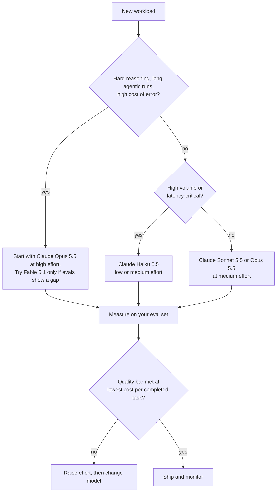

# Model Selection Cheat Sheet

> **As of 2026-10-24.** Model names, prices and limits change often. The table below reflects the Claude API
> reference material cached on 2026-10-06 and current on 2026-10-24. Always confirm on the official
> [models overview](https://platform.claude.com/docs/en/about-claude/models/overview) and
> [pricing page](https://platform.claude.com/docs/en/about-claude/pricing) before you budget or ship.
> Concepts: [05 · Model selection](../05-claude-products-and-models/03-model-selection.md).

## 1. Current models (Claude API, first-party prices)

| Model | API model ID | Context window | Max output | Input $/MTok | Output $/MTok | Best for |
|---|---|---|---|---|---|---|
| Claude Fable 5.1 | `claude-fable-5-1` | 1M | 128K | $10.00 | $50.00 | The hardest reasoning and long-horizon agentic work, when cost matters less than capability |
| Claude Opus 5.5 | `claude-opus-5-5` | 1M | 128K | $4.00 | $20.00 | Default choice: complex coding, agents, analysis, architecture |
| Claude Sonnet 5.5 | `claude-sonnet-5-5` | 1M | 128K | $2.00 | $10.00 | Everyday coding, agents and enterprise workloads with a speed/cost balance |
| Claude Haiku 5.5 | `claude-haiku-5-5` | 1M | 128K | $0.10 | $0.50 | High-volume, latency-sensitive tasks: classification, extraction, routing, sub-agents |

MTok = one million tokens. Haiku 5.5 prices apply to prompts up to 100K tokens ($0.50 / $2.50 beyond).
Previous-generation models (for example `claude-opus-5`, `claude-sonnet-5`, `claude-opus-4-8`) are still served;
see the models overview for their status and retirement dates. Use IDs exactly as written: **no date suffixes**.

Prices on Amazon Bedrock and Google Vertex AI are set by those platforms; Microsoft Foundry bills at Anthropic API
rates through its marketplace. Check the provider's pricing page.

## 2. Price modifiers

| Modifier | Effect |
|---|---|
| Message Batches | 50% off input and output; asynchronous, up to 24 hours |
| Prompt cache write | About 1.25x base input (5-minute TTL) or 2x (1-hour TTL) |
| Prompt cache read | About 0.1x base input (0.05x on Claude Opus 5.5, 0.025x on Claude Fable 5.1) |
| Fast mode (research preview) | Claude Opus 5.5 at $8 / $40 per MTok on the Claude API only; higher output speed |
| Effort level | Lower effort = fewer thinking and output tokens; the biggest in-model cost lever |

## 3. Decision guide

## 4. Rules of thumb

1. **Measure, do not guess.** Run the same eval set across candidate models and effort levels. Judge by cost
   **per completed task**, not per request: a cheap model that needs retries can cost more.
2. **Tune effort before switching models.** The most capable model at lower effort often matches a smaller model at
   higher effort, and keeps one prompt cache.
3. **Route by task, not by team.** A support pipeline can use Haiku to classify, Sonnet to draft and Opus to handle
   escalations.
4. **Use the right model for sub-agents.** Orchestrator on Opus, reading-heavy workers on Haiku or Sonnet.
5. **Batch anything that can wait.** Nightly summarisation, back-fills and evaluations belong in Message Batches.
6. **Respect data-retention rules.** Some models (for example Claude Fable 5.1) require 30-day data retention and are
   not available under zero data retention unless Anthropic authorises it.
7. **Plan migrations.** New models change behaviour and sometimes reject old parameters. Re-run evals, re-baseline token
   counts with `count_tokens`, and read the migration guide.

## 5. Matching model to task (examples)

| Task | Suggested starting point | Why |
|---|---|---|
| Classify 2 million support emails overnight | Haiku 5.5 + Batches | Volume, latency tolerant, simple labels |
| Live chat assistant for an internal help desk | Sonnet 5.5, low or medium effort | Responsive, capable enough for multi-turn |
| Refactor a large codebase with an agent | Opus 5.5, high or xhigh effort | Long-horizon tool use, cost of error |
| Draft a regulatory impact analysis for review | Opus 5.5, high effort | Careful reasoning, human review afterwards |
| Extract fields from scanned invoices | Haiku 5.5 or Sonnet 5.5 + structured outputs | Schema-bound extraction; test on real samples |
| Research agent that reads hundreds of sources | Opus 5.5 orchestrator, Haiku 5.5 workers | Split reading cost from synthesis quality |

## 6. Claude apps (claude.ai) users

In the Claude apps you pick a model from the model selector, subject to your plan and your organisation's settings.
The same trade-off applies: larger models for harder thinking, smaller ones for quick tasks. CCAO-F objective
CCAO-F-3.2 and CCAO-F-3.3 cover this; see [05 · Model families](../05-claude-products-and-models/02-model-families.md).

## Further reading

- [Models overview](https://platform.claude.com/docs/en/about-claude/models/overview)
- [Pricing](https://platform.claude.com/docs/en/about-claude/pricing)
- [Choosing a model](https://platform.claude.com/docs/en/about-claude/models/choosing-a-model)
- [15 · Cost optimisation](../15-production-operations/03-cost-optimisation.md)
