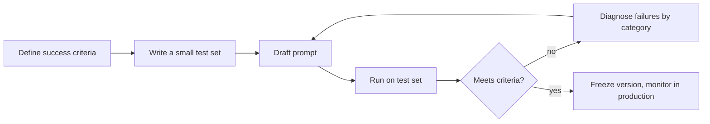

# Prompt Engineering Cheat Sheet

> **As of 2026-10-24.** Techniques here are model-agnostic in spirit but written for current Claude models, which
> follow instructions closely, reason adaptively and do **not** accept assistant prefill or sampling parameters.
> Full lessons: [03 · Prompt engineering](../03-prompt-engineering/README.md). Official guide:
> [Prompt engineering overview](https://platform.claude.com/docs/en/build-with-claude/prompt-engineering/overview).

## 1. The ten-second checklist

1. **Goal**: what should exist when Claude is done?
2. **Audience and use**: who reads it, and what will they do with it?
3. **Context**: the facts, documents and constraints Claude cannot guess.
4. **Format**: length, structure, schema, tone.
5. **Success criteria**: how you will judge the answer.
6. **Escape hatch**: what Claude should do when information is missing ("say so; do not guess").

If a capable new colleague would need to ask a clarifying question, your prompt is missing something.

## 2. Anatomy of a strong prompt

```text
<role>You are a claims analyst at Fabrikam Insurance.</role>

<context>
The attached policy wording and claim notes are the only sources you may use.
</context>

<task>
Decide whether the water-damage claim is covered, and explain why.
</task>

<constraints>
- Quote the clause you rely on.
- If the documents do not settle the question, answer "Needs adjuster review" and list what is missing.
- Maximum 200 words.
</constraints>

<documents>
  <document index="1" title="policy.pdf">...</document>
  <document index="2" title="claim-notes.txt">...</document>
</documents>
```

Put long documents **before** the question; put instructions where they are easy to find; use consistent XML tag
names and refer to them by name ("using the clause in `<document index="1">`").

## 3. Technique quick reference

| Technique | Use it when | How | Watch out for |
|---|---|---|---|
| Clear, direct instructions | Always | State the goal, constraints and output in plain sentences | Vague verbs ("handle", "improve") |
| Give the reason | Rules that look arbitrary | "Keep it under 50 words *because it shows on a phone notification*" | Over-explaining trivial rules |
| XML tags | Mixing instructions, data and examples | `<instructions>`, `<document>`, `<example>` | Inconsistent tag names |
| Few-shot examples | Format or tone is hard to describe | 2–5 varied examples in `<example>` tags | Examples that are too similar (Claude copies quirks) |
| Let Claude think | Multi-step reasoning, analysis, maths | Adaptive thinking plus `effort`; or ask for reasoning in `<analysis>` before `<answer>` | Paying for deep reasoning on trivial tasks |
| Task decomposition / chaining | Long or multi-stage work | Split into steps; pass outputs between calls | Losing context between steps |
| Structured outputs | Machine consumers | `output_config.format` JSON Schema or `messages.parse()` | Mixing free text into JSON |
| System prompt for role and rules | Persistent behaviour across turns | Operator rules, persona, safety boundaries | Stuffing task data into the system prompt |
| Grounding and quotes | Accuracy over documents | "Quote the relevant passage first, then answer" or enable citations | Asking for citations without supplying sources |
| Positive framing | Style control | "Write in flowing prose paragraphs" rather than "no bullet points" | Long lists of "never" rules |
| Self-check | High-stakes outputs | "Before finishing, verify each figure against the table" | Treating self-check as a substitute for evaluation |

## 4. Controlling output on current models

| You want | Do this | Not this |
|---|---|---|
| Valid JSON | Structured outputs (`output_config.format`) | Prefilling `{` (rejected with 400) |
| Shorter answers | State a length and a reason; lower `effort` for simple tasks | `temperature` (rejected) |
| More thorough reasoning | `thinking={"type": "adaptive"}` with `effort` `high`/`xhigh` | `budget_tokens` (legacy, rejected) |
| A specific tool call | `tool_choice: auto` plus "Use `lookup_order` for any order question"; `strict: true` on the tool | `tool_choice: {"type": "tool"}` (rejected) |
| Less preamble | "Start directly with the answer" | Hoping it happens |
| Consistent style | Few-shot examples plus a style guide | One adjective ("professional") |

## 5. Hallucination controls

- Supply the sources; tell Claude to answer **only** from them.
- Give explicit permission to say "I don't know" or "not in the documents".
- Ask for supporting quotes or use citations, then check them programmatically.
- Break claims into verifiable pieces; verify numbers against the source.
- Keep instructions and untrusted data separate (tags), so injected text in a document is treated as data.

More: [01 · Hallucinations](../01-ai-and-llm-fundamentals/06-hallucinations.md) and
[11 · Grounding and citations](../11-rag-and-knowledge-systems/05-grounding-and-citations.md).

## 6. Iteration loop



Change **one thing at a time**, keep the old version, and compare on the same inputs. A prompt is code: version it,
review it and test it. See [03 · Iterating on prompts](../03-prompt-engineering/08-iterating-on-prompts.md) and
[14 · Evaluation](../14-evaluation-and-testing/README.md).

## 7. Prompt smells

| Smell | Why it hurts | Fix |
|---|---|---|
| ALL-CAPS warnings and "CRITICAL" everywhere | Current models over-apply emphatic rules | Calm, specific instructions with reasons |
| Contradictory rules | The model has to pick one | Resolve conflicts; state priority |
| Instructions buried in the middle of a long document | Easy to miss | Put instructions before or after the data, clearly tagged |
| "Be creative but accurate and short but complete" | Competing goals | Prioritise ("accuracy first, then brevity") |
| Dates or IDs that change every request in the system prompt | Breaks prompt caching | Put volatile data in the latest user message |
| Old workarounds for older models (prefill, "think step by step" on every call) | Redundant or rejected | Use adaptive thinking, effort and structured outputs |

## 8. Business-user patterns (Claude apps)

| Situation | Pattern |
|---|---|
| Recurring work for a team | Put shared instructions and reference files in a **Project** |
| Long conversation drifting | Ask for a summary, start a fresh chat, paste the summary |
| Output for a document or slide | Ask for an artifact in the target format |
| Research question | Use research mode, then verify the cited sources yourself |
| Sensitive data | Follow your organisation's policy; remove personal data you do not need |

## Further reading

- [Prompt engineering overview](https://platform.claude.com/docs/en/build-with-claude/prompt-engineering/overview)
- [Claude prompting best practices](https://platform.claude.com/docs/en/build-with-claude/prompt-engineering/claude-prompting-best-practices)
- [03 · Structure with XML tags](../03-prompt-engineering/02-structure-with-xml-tags.md)
- [03 · Structured output](../03-prompt-engineering/06-structured-output.md)
