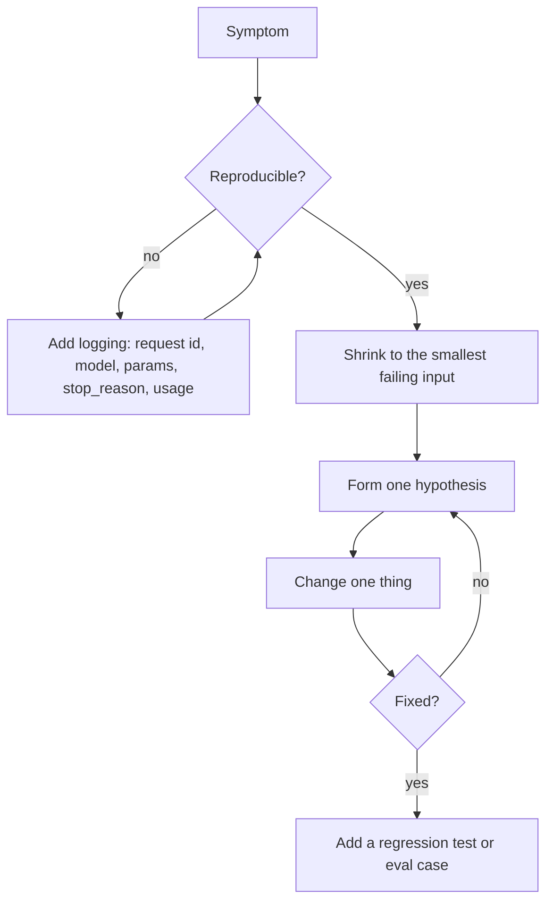

# 24 · Troubleshooting

When something goes wrong with a Claude integration, an agent, Claude Code or one of this repository's labs, start
here. Every page uses the same four-step structure so you can scan quickly:

| Step | Question it answers |
|---|---|
| **Symptom** | What do you see? (an error, a wrong answer, a hang) |
| **Likely cause** | What usually produces that symptom? |
| **Diagnosis** | How do you confirm the cause, cheaply and safely? |
| **Fix** | What change resolves it, and how do you stop it recurring? |

> **As of 2026-10-24.** Error messages, limits and commands change. Where a page quotes an API behaviour it is dated
> and links to the official docs.

## Pages

| Page | Use it when |
|---|---|
| [API errors](api-errors.md) | You get an HTTP error from the Claude API (400, 401, 403, 404, 413, 429, 500, 529) or a streaming error |
| [Prompts and outputs](prompts-and-outputs.md) | The call succeeds but the answer is wrong, invented, too long, in the wrong format, or refused |
| [Tools and agents](tools-and-agents.md) | Tool calls fail, the agent loops, picks the wrong tool or never finishes |
| [Claude Code](claude-code.md) | Claude Code ignores `CLAUDE.md`, keeps prompting, a hook misfires, or settings do not apply |
| [MCP](mcp.md) | An MCP server will not connect, authenticate or show its tools |
| [RAG](rag.md) | Retrieval returns the wrong passages, misses obvious ones, or serves outdated content |
| [Labs and repository](labs-and-repository.md) | A lab will not run, mock and live mode behave differently, the virtual environment is broken, or a repo check fails |

## A general method

1. **Capture the evidence first:** the `request-id` response header, model ID, parameters, `stop_reason`, `usage` and
   the exact error body. Never log API keys or unnecessary personal data.
2. **Reproduce small:** strip the request to the minimum that still fails.
3. **Change one variable at a time** and keep notes.
4. **Prevent recurrence:** a unit test, an eval case, a hook or a monitoring alert.

## Escalation

- Service-wide problems: check the [Anthropic status page](https://status.anthropic.com).
- API behaviour: the [errors reference](https://platform.claude.com/docs/en/api/errors) and
  [rate limits](https://platform.claude.com/docs/en/api/rate-limits).
- Claude Code: [troubleshooting docs](https://code.claude.com/docs/en/troubleshooting) and `claude doctor`.
- MCP: the [specification](https://modelcontextprotocol.io/specification/latest) and your server's own logs.
- This repository: open an issue following [CONTRIBUTING](../CONTRIBUTING.md). For security problems, follow
  [SECURITY](../SECURITY.md) instead of filing a public issue.

Related: [15 · Production operations](../15-production-operations/README.md),
[14 · Diagnosing failures](../14-evaluation-and-testing/06-diagnosing-failures.md).
