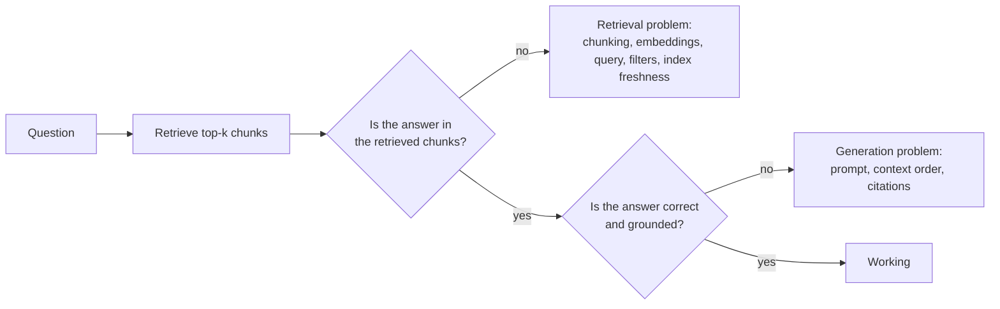

# Troubleshooting: RAG (Retrieval-Augmented Generation)

In a RAG system, most "the model is wrong" reports are really **retrieval** problems: the right passage never reached
Claude. Debug retrieval and generation separately. Concepts:
[11 · RAG and knowledge systems](../11-rag-and-knowledge-systems/README.md),
[11 · RAG evaluation](../11-rag-and-knowledge-systems/06-rag-evaluation.md).

## Split the problem in two

Keep a labelled set of questions with the document IDs that should be retrieved. Measure **recall@k** (did the right
chunk appear in the top k?) separately from answer correctness and faithfulness.

## Bad retrieval: relevant passage not found

**Symptom:** answers say "not found" or are generic, even though the information exists in your corpus.

**Likely causes:**

| Cause | Telltale sign |
|---|---|
| Chunks too large | The right chunk ranks low because most of it is about something else |
| Chunks too small or split mid-thought | The fact is retrieved without its subject ("It expires after 30 days") |
| Vocabulary mismatch | Users say "PTO", documents say "annual leave" |
| Exact identifiers | Part numbers, error codes or names that embeddings handle poorly |
| Over-strict metadata filters | Right document excluded by a wrong department or date filter |
| Wrong or mixed embedding models | Query embedded with a different model or version than the index |
| Document never ingested | Parser failed on a PDF table or scanned image |

**Diagnosis:** for each failing question, look up where the answer lives, then check: was it ingested? what does the
chunk look like? what rank does it get? what similarity score?

**Fix:**

- Tune chunk size and overlap on your eval set; split on document structure (headings, sections) rather than fixed
  character counts; prepend a short context line to each chunk (document title, section).
- Add **hybrid search** (keyword/BM25 plus vectors) for identifiers and rare terms.
- Add a **reranker** over a larger candidate set (retrieve 50, rerank to 5).
- Rewrite or expand the query (synonyms, a model-generated search query) before retrieval.
- Loosen or fix filters; log the filters applied per query.
- Re-embed the whole corpus whenever you change embedding model or version.
- Fix ingestion: OCR for scans, table-aware parsing, alerts on parse failures.

See [11 · Chunking strategies](../11-rag-and-knowledge-systems/02-chunking-strategies.md) and
[11 · Retrieval strategies](../11-rag-and-knowledge-systems/04-retrieval-strategies.md).

## Bad retrieval: too much irrelevant context

**Symptom:** answers mix unrelated material, cite the wrong document, or cost too much.

**Likely causes:** top-k too high; near-duplicate chunks; no reranking; boilerplate (headers, footers, navigation)
indexed as content.

**Fix:** lower k after reranking; de-duplicate at ingestion; strip boilerplate; give each chunk metadata so Claude can
tell sources apart; place the most relevant chunks first.

## Stale index: answers reflect old content

**Symptom:** answers quote a superseded policy, price or procedure; users report "that changed last month".

**Likely causes:**

- Ingestion runs on a schedule that lags the source system.
- Updated documents were added as new chunks while old chunks stayed in the index.
- Deletes in the source never propagate (no tombstones).
- Caches (prompt cache, application answer cache) keep serving older context.
- Several versions of a document coexist without version metadata.

**Diagnosis:**

1. For a stale answer, find which chunk IDs were retrieved and their `source_updated_at` / ingestion timestamp.
2. Compare the index's document count and checksums with the source system.
3. Check the ingestion job's last successful run and error log.

**Fix:**

- Use stable document IDs and **upsert**: delete all chunks for a document before inserting its new chunks.
- Propagate deletes; run a periodic reconciliation job (source inventory vs index).
- Store `version`, `effective_date` and `source_updated_at` as metadata; filter or boost by recency; tell Claude to
  prefer the newest effective version and to mention the date it relied on.
- Trigger re-indexing from source change events where possible, not only on a timer.
- Invalidate application-level answer caches when sources change.
- Monitor index freshness (age of newest ingested change) as an operational metric with an alert.

## Generation problems with good retrieval

| Symptom | Likely cause | Fix |
|---|---|---|
| Answer contradicts the retrieved text | Instructions do not require grounding | "Answer only from the provided sources; quote them" |
| Correct facts, no citations | Citations not requested | Enable citations on document blocks, or require quotes with source IDs |
| Model blends two sources incorrectly | Chunks lack source labels | Wrap each chunk in `<source id="..." title="..." date="...">` tags |
| Ignores the middle of long context | Too many chunks; key passage buried | Fewer, reranked chunks; most relevant first |
| Answers questions outside the corpus | No refusal path | "If the sources do not answer, say so" |

## Access-control failures

**Symptom:** a user sees content from documents they are not allowed to read.

**Likely cause:** permissions applied after generation, or not at all; a shared index without tenant filters.

**Fix:** enforce document-level permissions **at retrieval time** (filter by the user's groups before ranking);
separate indexes or namespaces per tenant; test with users of different roles; log which document IDs each answer
used. See [12 · Data exfiltration and disclosure](../12-ai-security/04-data-exfiltration-and-disclosure.md).

## Poisoned or injected content

**Symptom:** answers include odd instructions, links or actions that trace back to one document.

**Fix:** control who can add content to the corpus; review changes to high-trust collections; tag retrieved text as
untrusted data in the prompt; never let retrieved content trigger tools without approval. See
[12 · Indirect prompt injection](../12-ai-security/03-indirect-prompt-injection.md).

## When RAG is the wrong tool

If the corpus is small and stable, putting it directly in context with prompt caching may be simpler and more
accurate than retrieval. See [11 · RAG vs long context](../11-rag-and-knowledge-systems/07-rag-vs-long-context.md).
