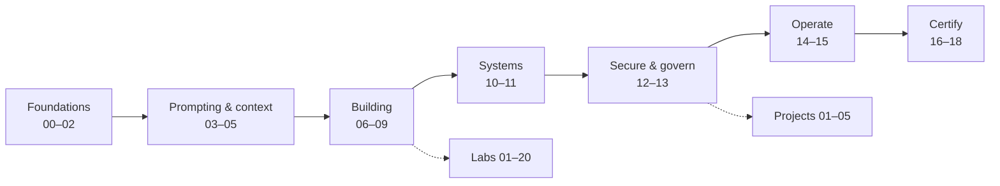

<div align="center">

# Claude Certification: Zero to Hero (Unofficial)

**From Your First Prompt to Production-Ready AI Architecture.**

An open, original learning path that takes you from never having used Claude to preparing for Anthropic's
certification exams, and to building secure, production-grade AI systems.

[](.github/workflows/ci.yml)
[](LICENSE)
[](LICENSE)
[](25-official-resources/verification-log.md)
[](#disclaimer)

</div>

---

## Why this repository exists

Anthropic now runs a formal [Claude Certification Program](25-official-resources/exam-facts.md). The official exam
guides list *what* is tested; they do not teach it. This repository fills that gap with:

- a **zero-to-hero curriculum** (16 modules) that assumes no prior AI knowledge,
- **certification tracks** that map every official exam objective to a lesson, a lab and practice questions,
- **hands-on labs and projects** that run free and offline by default,
- a dedicated **AI security track** for engineers who must ship safely,
- an **offline mock-exam engine** for independent practice.

It is also designed to be a practical reference long after the exam.

## Who it's for

| You are… | Start here | Then |
|---|---|---|
| New to AI entirely | [00 Getting started](00-getting-started/README.md) → [01 AI & LLM fundamentals](01-ai-and-llm-fundamentals/README.md) | The 30- or 60-day roadmap |
| A business or knowledge worker using Claude | [05 Products & models](05-claude-products-and-models/README.md) | The [CCAO-F track](16-certification-tracks/ccao-f/README.md) |
| A software, DevOps or cloud engineer | [06 Claude API](06-claude-api/README.md) → [07 Tool use](07-tool-use-and-function-calling/README.md) | Labs 07–12 |
| A security or DevSecOps engineer | [12 AI security](12-ai-security/README.md) | Labs 13–15 and 18–20, projects 03–05 |
| A solution or enterprise architect | [13 Enterprise AI architecture](13-enterprise-ai-architecture/README.md) | The [CCAR-P track](16-certification-tracks/ccar-p/README.md) |
| A technical leader | [13 Architecture](13-enterprise-ai-architecture/README.md), [15 Production operations](15-production-operations/README.md) | [Interview & stakeholder prep](21-interview-preparation/README.md) |

Not sure? Take the two-minute [choose-your-path guide](00-getting-started/choose-your-path.md).

## Certification tracks

| Certification | Code | Audience | Track |
|---|---|---|---|
| Claude Certified Associate – Foundations | CCAO-F | Business users of the Claude apps | [Full track](16-certification-tracks/ccao-f/README.md) |
| Claude Certified Architect – Professional | CCAR-P | Architects delivering production systems | [Full track](16-certification-tracks/ccar-p/README.md) |
| Claude Certified Architect – Foundations | CCAR-F | Developers building agentic systems | Planned ([roadmap](ROADMAP.md)) |
| Claude Certified Developer – Foundations | CCDV-F | Developers building on the API | Planned ([roadmap](ROADMAP.md)) |

Exam formats, fees, eligibility and blueprints were verified against the official exam guides on 2026-10-24. See
[exam facts](25-official-resources/exam-facts.md) and the machine-readable [registry](16-certification-tracks/registry.yaml).
Anthropic plans updated guides on 2026-11-17.

## The learning journey



| Stage | Modules | You'll be able to… |
|---|---|---|
| **1. Foundations** | [00](00-getting-started/README.md) · [01](01-ai-and-llm-fundamentals/README.md) · [02](02-claude-fundamentals/README.md) | Explain how LLMs work, what tokens and context windows are, and why hallucinations happen |
| **2. Prompting & context** | [03](03-prompt-engineering/README.md) · [04](04-context-engineering/README.md) · [05](05-claude-products-and-models/README.md) | Write reliable prompts, manage context and caching, choose the right model and product feature |
| **3. Building** | [06](06-claude-api/README.md) · [07](07-tool-use-and-function-calling/README.md) · [08](08-model-context-protocol/README.md) · [09](09-claude-code/README.md) | Integrate the API, build tool-using apps, write MCP servers and roll out Claude Code |
| **4. Systems** | [10](10-agentic-ai/README.md) · [11](11-rag-and-knowledge-systems/README.md) | Design workflows, agents, multi-agent systems and RAG pipelines |
| **5. Secure & govern** | [12](12-ai-security/README.md) · [13](13-enterprise-ai-architecture/README.md) | Threat-model LLM apps, defend against prompt injection and design compliant enterprise architectures |
| **6. Operate** | [14](14-evaluation-and-testing/README.md) · [15](15-production-operations/README.md) | Build evals, observe, optimise cost and latency, and run AI in production |
| **7. Certify** | [16](16-certification-tracks/README.md) · [17](17-practice-questions/README.md) · [18](18-mock-examinations/README.md) | Prepare objective by objective and practise under exam conditions |

## Study plans

| Plan | Suits | Link |
|---|---|---|
| 7-day accelerated introduction | Experienced engineers who want a fast overview | [7-day](00-getting-started/roadmaps/7-day-accelerated.md) |
| 15-day preparation | People already using Claude who are preparing for CCAO-F | [15-day](00-getting-started/roadmaps/15-day-preparation.md) |
| 30-day structured plan | Beginners with a few hours a week | [30-day](00-getting-started/roadmaps/30-day-structured.md) |
| 60-day comprehensive plan | Engineers preparing for CCAR-P | [60-day](00-getting-started/roadmaps/60-day-comprehensive.md) |
| 90-day enterprise AI engineering | Architects and security engineers building production capability | [90-day](00-getting-started/roadmaps/90-day-enterprise-engineering.md) |

## Practise

```bash
python3 -m venv .venv && source .venv/bin/activate
pip install -r requirements-dev.txt

# Mock exams in the terminal (timed or learning mode)
python 18-mock-examinations/run_mock_exam.py --track CCAO-F --mode learn

# ...or in the browser
python3 -m http.server 8000     # then open http://localhost:8000/18-mock-examinations/web/

# Run a lab offline (no API key, no cost)
python 19-hands-on-labs/lab-01-first-claude-interaction/lab.py
```

- **[Practice questions](17-practice-questions/README.md):** unofficial, schema-validated, every distractor explained
- **[Mock examinations](18-mock-examinations/README.md):** timed and learning modes, domain breakdowns, weak-area advice
- **[Flashcards](23-flashcards/README.md):** YAML decks, exportable to Anki
- **[Cheat sheets](22-cheat-sheets/README.md):** one-page summaries for the API, prompting, Claude Code, MCP, security and each exam

## Read it as a website

Everything here is also published as a searchable website with light and dark themes and the interactive practice
exam built in. The site is built from this repository with [MkDocs](https://www.mkdocs.org/) and
[Material for MkDocs](https://squidfunk.github.io/mkdocs-material/), and deployed to GitHub Pages on every push to `main`
(see [`.github/workflows/pages.yml`](.github/workflows/pages.yml)).

Preview it locally:

```bash
pip install -r requirements-docs.txt
python tools/build_site.py --serve      # http://127.0.0.1:8000
```

## Hands-on

- **[20 labs](19-hands-on-labs/README.md)**, from a first API call to a secure AI gateway. Every lab runs in free,
  offline **mock mode**, and in **live mode** with your own API key (clearly marked when it costs credits).
- **[5 real-world projects](20-real-world-projects/README.md)** of increasing difficulty: a document summariser, a
  knowledge-base Q&A assistant, a security alert triage assistant, a DevSecOps code-review assistant and an agentic
  investigation assistant. Each has requirements, an architecture, security design, tests and cost estimates.

## Repository map

| # | Section | # | Section |
|---|---|---|---|
| 00 | [Getting started](00-getting-started/README.md) | 13 | [Enterprise AI architecture](13-enterprise-ai-architecture/README.md) |
| 01 | [AI & LLM fundamentals](01-ai-and-llm-fundamentals/README.md) | 14 | [Evaluation & testing](14-evaluation-and-testing/README.md) |
| 02 | [Claude fundamentals](02-claude-fundamentals/README.md) | 15 | [Production operations](15-production-operations/README.md) |
| 03 | [Prompt engineering](03-prompt-engineering/README.md) | 16 | [Certification tracks](16-certification-tracks/README.md) |
| 04 | [Context engineering](04-context-engineering/README.md) | 17 | [Practice questions](17-practice-questions/README.md) |
| 05 | [Claude products & models](05-claude-products-and-models/README.md) | 18 | [Mock examinations](18-mock-examinations/README.md) |
| 06 | [Claude API](06-claude-api/README.md) | 19 | [Hands-on labs](19-hands-on-labs/README.md) |
| 07 | [Tool use & function calling](07-tool-use-and-function-calling/README.md) | 20 | [Real-world projects](20-real-world-projects/README.md) |
| 08 | [Model Context Protocol](08-model-context-protocol/README.md) | 21 | [Interview preparation](21-interview-preparation/README.md) |
| 09 | [Claude Code](09-claude-code/README.md) | 22 | [Cheat sheets](22-cheat-sheets/README.md) |
| 10 | [Agentic AI](10-agentic-ai/README.md) | 23 | [Flashcards](23-flashcards/README.md) |
| 11 | [RAG & knowledge systems](11-rag-and-knowledge-systems/README.md) | 24 | [Troubleshooting](24-troubleshooting/README.md) |
| 12 | [AI security](12-ai-security/README.md) | 25 | [Official resources](25-official-resources/README.md) |

Also: [Glossary](GLOSSARY.md) · [FAQ](FAQ.md) · [Roadmap](ROADMAP.md) · [Progress tracker](PROGRESS.md) · [Changelog](CHANGELOG.md)

## Quality and integrity

Every pull request is checked automatically:

- practice-question schema, unique IDs, answer keys and distractor rationales, plus near-duplicate detection,
- internal links and anchors, plus a weekly external link check,
- objective coverage (every official objective → module → lab → questions),
- exam facts consistent with the registry and linked to a source,
- all labs executed in mock mode, repository and project tests,
- secret scanning (gitleaks plus a local scanner) and markdown lint.

Run everything locally with `python tools/validate_all.py --labs`.

## Contributing

Contributions are welcome. Read [CONTRIBUTING.md](CONTRIBUTING.md) and the [documentation standards](docs/STYLE.md).
The two non-negotiables: **original work only**, and **no real exam content, ever**.

## Official resources

Use these as your source of truth: the
[Anthropic Partner Academy certifications page](https://anthropic-partners.skilljar.com/page/partner-certifications)
(exam guides and policies), [Pearson VUE](https://www.pearsonvue.com/us/en/anthropic.html) (scheduling),
[Anthropic Academy](https://anthropic.skilljar.com/) (free courses), the [Claude docs](https://platform.claude.com/docs),
[Claude Code docs](https://code.claude.com/docs) and [modelcontextprotocol.io](https://modelcontextprotocol.io).
More in [25 · Official resources](25-official-resources/README.md).

## Disclaimer

This is an **independent, community study resource**. It is **not affiliated with, sponsored by or endorsed by
Anthropic**. "Claude", "Anthropic" and the certification names are trademarks of Anthropic, PBC, and are used here only to
identify the products and exams this guide is about. The repository uses no Anthropic logos or artwork.

- The maintainer and contributors do not speak for Anthropic, and nothing here is official guidance or a promise about
  exam content or results.

- All practice and mock-exam questions are **original and unofficial**. None comes from, or is reconstructed from, a
  real exam. Mock-exam percentages are **not** Anthropic scaled scores and do not predict official results.
- Exam details can change. Always confirm with the official exam guide before you register or sit an exam.
- Product facts, model names and prices are dated where stated, and may have changed since.
- All organisations, people and data in examples are fictional. Several organisation names (such as Contoso, Fabrikam
  and Northwind) are fictional sample names popularised in Microsoft documentation; any resemblance to real
  organisations or people is coincidental.
- Third-party names (Amazon Bedrock, Google Cloud, Microsoft Foundry, OWASP, NIST and others) are trademarks of their
  owners and appear only for identification and reference.

## Licence

Code is released under the MIT License and educational content under CC BY 4.0. See [LICENSE](LICENSE).
